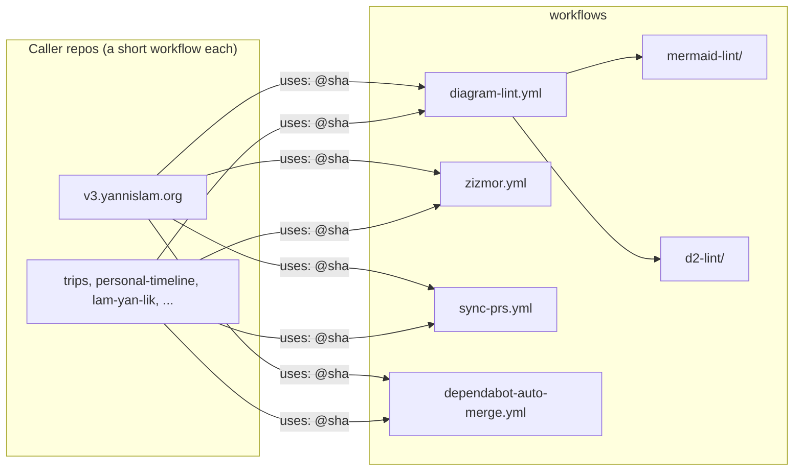

# workflows

Shared GitHub Actions for the AardeYamz repos: reusable workflows and the diagram linters they run. Each repo keeps a short caller workflow with its own triggers and `uses:` a template from here pinned by SHA, so CI logic and action bumps live in one place.

Public on purpose: GitHub doesn't let a public repo call a private repo's workflows. Keep it free of secrets and repo-specific values.

## Architecture



| Where | What |
|---|---|
| `.github/workflows/` | the four reusable workflows, and `selftest.yml` (runs the linters from source on every PR) |
| `mermaid-lint/`, `d2-lint/` | composite actions: parse every tracked mermaid block, compile every `*.d2` file and d2 block |

## Reusable workflows

| Workflow | Inputs | What it does |
|---|---|---|
| [`diagram-lint.yml`](.github/workflows/diagram-lint.yml) | `mermaid` (default `true`), `d2` (default `false`) | Runs the diagram linters on the caller's repo |
| [`zizmor.yml`](.github/workflows/zizmor.yml) | `advanced-security` (default `true`) | Lints the caller's workflow files with [zizmor](https://docs.zizmor.sh) and uploads SARIF |
| [`sync-prs.yml`](.github/workflows/sync-prs.yml) | `base`, `ci-owned-paths`, `dispatch-workflows`, `dispatch-on-base` | Merges the base branch into each open, behind, same-repo PR; comments on conflicts |
| [`dependabot-auto-merge.yml`](.github/workflows/dependabot-auto-merge.yml) | `required-workflow`, `merge-method`, `timeout-minutes` | Merges patch/minor Dependabot PRs once checks pass |

Every workflow also takes `runs-on` (default: the caller's `vars.RUNNER`, else `ubuntu-26.04`). Each file's header has a sample caller and the permissions the caller must grant.

```yaml
jobs:
  diagrams:
    uses: AardeYamz/workflows/.github/workflows/diagram-lint.yml@<sha> # v1.0.0
    with:
      d2: true
```

Run a linter locally from the repo you want to check: `npm ci --prefix <path to workflows>/mermaid-lint && node <path to workflows>/mermaid-lint/lint.mjs`.

## Related repos

| Repo | Relationship |
|---|---|
| [personal-domain-devops](https://github.com/AardeYamz/personal-domain-devops) | Private CI infrastructure (deploy action, runners); calls these workflows |
| [v3.yannislam.org](https://github.com/AardeYamz/v3.yannislam.org) | Public caller, the reason this repo is public |
| [personal-server](https://github.com/AardeYamz/personal-server) | Hosts the self-hosted runners that run these jobs |

## Releasing

1. Branch and PR; `selftest.yml` checks the linters reject broken diagrams.
2. If a linter changed, bump the SHA `diagram-lint.yml` pins, in a follow-up PR.
3. After merging, tag `vX.Y.Z`, create a release and move `v1`. Callers then bump to the new SHA with `# vX.Y.Z` as the comment.

[MIT](LICENSE)
