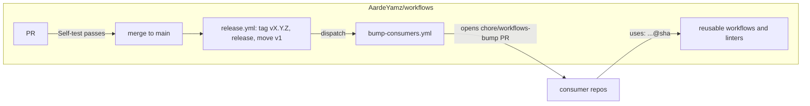

# workflows

[](https://github.com/AardeYamz/workflows/actions/workflows/selftest.yml)
[](https://github.com/AardeYamz/workflows/releases/latest)
[](https://github.com/AardeYamz/workflows/actions/workflows/bump-consumers.yml)
[](https://scorecard.dev/viewer/?uri=github.com/AardeYamz/workflows)
[](https://docs.zizmor.sh)
[](https://mermaid.js.org)
[](https://www.npmjs.com/package/@terrastruct/d2)
[](https://nodejs.org/)
[](.github/dependabot.yml)
[](LICENSE)

Shared GitHub Actions for the AardeYamz repos: reusable workflows and the diagram linters they run. Each repo keeps a short caller workflow (its own triggers, concurrency and permissions) that `uses:` a template from here pinned by SHA, so CI logic and action bumps live in one place.

Public on purpose: a public repo can't use a private repo's workflows. Keep it free of secrets, hostnames and anything repo-specific; those belong in the callers.

## How it works



1. A PR here runs [`selftest.yml`](.github/workflows/selftest.yml): the linters from source, their broken-diagram fixtures, and the templates at the PR's commit.
2. Merging releases it: [`release.yml`](.github/workflows/release.yml) tags the next `vX.Y.Z` (patch by default; label the PR `release:minor`, `release:major` or `release:skip`), creates a release and moves `v1`. Merges touching only Markdown, `LICENSE`, the ruleset or `consumers.json` release nothing. **Run workflow** on Release does it by hand.
3. It then dispatches [`bump-consumers.yml`](.github/workflows/bump-consumers.yml), which opens or updates a `chore/workflows-bump` PR in each consumer, repinning `uses: AardeYamz/workflows/...@<sha> # vX.Y.Z`. Needs the `CONSUMER_PAT` secret (fine-grained: Contents, Pull requests and Workflows write on the consumers). Consumers merge it like any other PR.

## Repo layout

```
.github/
  workflows/        reusable templates (workflow_call) and this repo's own workflows
  rulesets/         default-branch ruleset (JSON, applied with gh api)
  consumers.json    repos Bump consumers and apply-repo-settings.sh act on
  repo-settings.json  repo settings every repo gets (applied by scripts/apply-repo-settings.sh)
  dependabot.yml    weekly action and npm bumps
  zizmor.yml        zizmor settings for this repo
mermaid-lint/       composite action: action.yml + lint.mjs, fixtures in test/
d2-lint/            same, for D2
scripts/            apply-repo-settings.sh, plus the local DevOps scripts (git/, github/, github-desktop/, shared common/)
SECURITY.md
```

## Reusable workflows

Every one also takes `runs-on` (default: the caller's `vars.RUNNER`, else `ubuntu-26.04`). Each file's header has a sample caller. Grant every permission listed: a called job can't get more than its caller grants.

| Workflow | Inputs | Caller grants | What it does |
|---|---|---|---|
| [`ci.yml`](.github/workflows/ci.yml) | `diagrams`, `d2`, `workflow-lint`, `zizmor`, `codeql`, `dependency-review`, `test`, `install`, `node-version`, `python-version`, `docs-only-paths`, `required` | One entry point: runs whichever of the checks below the caller turns on as jobs of one run, plus a test job that a docs-only PR skips (so required checks still report), and a final `ci / gate` job that fails unless every required job succeeded, so a repo can require just `ci / gate`. `required` narrows which jobs the gate waits for (default: every enabled one) |
| [`diagram-lint.yml`](.github/workflows/diagram-lint.yml) | `mermaid` (`true`), `d2` (`false`) | `contents: read` | Runs `mermaid-lint` and/or `d2-lint` |
| [`zizmor.yml`](.github/workflows/zizmor.yml) | `advanced-security` (`true`) | `contents: read`, `security-events: write`, `actions: read` | Lints workflow files with zizmor and uploads SARIF; `false` for private repos without code scanning (annotations and a failing job instead) |
| [`codeql.yml`](.github/workflows/codeql.yml) | `languages` (`javascript-typescript,actions`) | `contents: read`, `security-events: write`, `actions: read` | CodeQL analysis, uploaded to code scanning (needs code scanning) |
| [`dependency-review.yml`](.github/workflows/dependency-review.yml) | `fail-on-severity` (`moderate`) | `contents: read` | Fails a PR that adds a vulnerable dependency (`pull_request` only) |
| [`actionlint.yml`](.github/workflows/actionlint.yml) | none | Lints the caller's workflow files with [actionlint](https://github.com/rhysd/actionlint) (syntax, expressions, action inputs, shellcheck on `run:` scripts) |
| [`retry-failed.yml`](.github/workflows/retry-failed.yml) | `max-attempts` (default 3), `delay-seconds`, `max-delay-seconds` | Re-runs only the failed jobs of a run that ended in `failure`, up to `max-attempts` in all, with exponential backoff between attempts. The caller owns the `workflow_run` trigger and lists the workflows to retry. Needs `actions: write` |
| [`sync-prs.yml`](.github/workflows/sync-prs.yml) | `base` (`main`), `ci-owned-paths`, `dispatch-workflows`, `dispatch-on-base` | `contents: write`, `pull-requests: write`, `actions: write` | Merges the base into each open, behind, same-repo PR; comments on conflicts; skips Dependabot PRs and merges that would change `.github/workflows/**`; can re-run workflows on each updated branch or once on the base |
| [`bump-repos.yml`](.github/workflows/bump-repos.yml) | `repos`, `branch`, `title`, `cmd`, `paths`, `env` (secret `consumer-pat`) | Opens one PR per listed repo that runs a bump command there (repin shared workflows, pin the newest theme), on one fixed branch each. Used by this repo's `bump-consumers.yml` and yl-theme |
| [`dependabot-auto-merge.yml`](.github/workflows/dependabot-auto-merge.yml) | `required-workflow` (required), `merge-method` (`squash`), `timeout-minutes` (`30`) | `contents: write`, `pull-requests: write` | Waits for a Dependabot PR's checks, then merges patch/minor and dev-only majors. Caller uses `pull_request_target` (safe: nothing from the PR is checked out) |
| [`preview-build.yml`](.github/workflows/preview-build.yml) | `build`, `output`, `deploy-workflow`, `install`, `node-version`, `python-version` | Builds each open same-repo PR once per commit into an artifact `pr-<n>-<sha>` (no secrets), then dispatches the caller's deploy. A push builds one PR, not every open PR |
| [`preview-deploy.yml`](.github/workflows/preview-deploy.yml) | `build-workflow`, `deploy-command`, `preview-url`, `pr-path`, `main-build`, `main-output`, `main-dest`, `stage-command` | Stages the newest build of every open PR (plus the default branch, optionally), runs the caller's deploy command with `deploy-token` / `deploy-account-id` secrets, and comments each PR's preview link. Single-lane: a burst of builds ends in one or two deploys |

```yaml
jobs:
  diagrams:
    uses: AardeYamz/workflows/.github/workflows/diagram-lint.yml@<sha> # v1.0.1
    with:
      d2: true
```

## Workflows this repo runs itself

| Workflow | Runs on | What it does |
|---|---|---|
| [`selftest.yml`](.github/workflows/selftest.yml) | PR, push to `main`, manual | Linters from source and their fixtures, then `diagram-lint`, `zizmor`, `codeql` and `dependency-review` called locally (`./`); these are the required checks |
| [`release.yml`](.github/workflows/release.yml) | Push to `main`, manual | Tags and releases the next version, moves `v1`, dispatches Bump consumers |
| [`bump-consumers.yml`](.github/workflows/bump-consumers.yml) | Dispatched by Release, a pushed `vX.Y.Z` tag, manual | Repin PR in each consumer repo |
| [`sync-main.yml`](.github/workflows/sync-main.yml) | Push to `main`, manual | Calls `sync-prs.yml` here, then re-runs Self-test on each updated PR |
| [`scorecard.yml`](.github/workflows/scorecard.yml) | Weekly, push to `main`, branch protection changes, manual | OpenSSF Scorecard (repo-only; Scorecard won't publish from a reusable workflow) |

The [ruleset](.github/rulesets/default-branch-protection.json) blocks deletion and force-push on `main`, requires PRs with resolved threads, the Self-test checks and a code scanning gate; admins bypass through a PR only. Apply it with `gh api repos/AardeYamz/workflows/rulesets --method POST --input .github/rulesets/default-branch-protection.json` (`/rulesets/<id> --method PUT` to update). Secret scanning and push protection are on.

## Diagram linters

Also usable directly: `uses: AardeYamz/workflows/mermaid-lint@<sha>` (or `d2-lint`), after `actions/checkout`. `mermaid-lint` parses every mermaid block in tracked `*.md` files (jsdom supplies the DOM); `d2-lint` compiles every tracked `*.d2` file and d2 block with D2.js, the WASM build of d2, layout included, with `@import`s between tracked files resolved. Each prints `file:line: message`, adds `::error` annotations and exits 1 on any failure. Locally, from the repo you edited, with this one cloned next to it:

```
npm ci --prefix ../workflows/mermaid-lint && node ../workflows/mermaid-lint/lint.mjs
npm ci --prefix ../workflows/d2-lint && node ../workflows/d2-lint/lint.mjs
```

## Consumers

All private except v3.yannislam.org. Adding one: add its caller, then add it to [`.github/consumers.json`](.github/consumers.json) (read by Bump consumers and `apply-repo-settings.sh`) and to the `CONSUMER_PAT` token's repositories, then run **Bump consumers** by hand (editing the list releases nothing, so nothing else gets a PR).

| Repo | Calls |
|---|---|
| [37-bestick-rd](https://github.com/AardeYamz/37-bestick-rd) | `actionlint`, `diagram-lint`, `preview-build`, `preview-deploy`, `sync-prs` |
| [lam-yan-lik](https://github.com/AardeYamz/lam-yan-lik), [personal-timeline](https://github.com/AardeYamz/personal-timeline), [trips](https://github.com/AardeYamz/trips) | `actionlint`, `dependabot-auto-merge`, `diagram-lint`, `preview-build`, `preview-deploy`, `sync-prs` |
| [v3.yannislam.org](https://github.com/AardeYamz/v3.yannislam.org) | `actionlint`, `dependabot-auto-merge`, `dependency-review`, `diagram-lint`, `preview-build`, `preview-deploy`, `sync-prs`, `zizmor` |
| [yl-theme](https://github.com/AardeYamz/yl-theme) | `actionlint`, `dependabot-auto-merge`, `diagram-lint`, `sync-prs` |
| [personal-domain-devops](https://github.com/AardeYamz/personal-domain-devops) | `actionlint`, `dependabot-auto-merge`, `diagram-lint`, `zizmor` |
| [Organizing-Scripts](https://github.com/AardeYamz/Organizing-Scripts), [personal-dns-acl](https://github.com/AardeYamz/personal-dns-acl), [personal-server](https://github.com/AardeYamz/personal-server) | `actionlint`, `dependabot-auto-merge`, `diagram-lint` |
| [personal-dns](https://github.com/AardeYamz/personal-dns) | `actionlint`, `diagram-lint` |
| [personal-financial-scripts](https://github.com/AardeYamz/personal-financial-scripts) | `actionlint`, `dependabot-auto-merge` |

Repo settings that workflow YAML can't set (currently "Always suggest updating pull request branches") live in [`.github/repo-settings.json`](.github/repo-settings.json). Run `scripts/apply-repo-settings.sh` after changing it or adding a consumer; it patches this repo and every repo in `consumers.json` with your own `gh` login (admin needed), or just the repos you pass as arguments.

When a linter changes, bump the SHA `diagram-lint.yml` pins it to in a follow-up PR, so the next release carries it.

## Local DevOps scripts

Run by hand on a workstation (moved here from Organizing-Scripts); personal-domain-devops also runs `worktrees.py prune` and `repos.py` across the personal repos from its own workflows. Dry runs unless `--apply`, and `--repo` takes one or more names (comma separated or repeated) to limit any of them.

| Script | What it does |
|---|---|
| `scripts/git/worktrees.py sync` | Fetches every repo under `~/GitHub`, fast-forwards each main checkout to `origin/<default>` and merges `origin/<default>` into each clean worktree in `~/GitHub/.worktrees`. Skips dirty trees, detached HEADs and merged branches; a conflicting merge is aborted and reported. Never pushes. |
| `scripts/git/worktrees.py prune` | Removes worktrees and local branches whose tip is merged into `origin/<default>` or is the head of a merged PR (squash merges count; needs `gh`). Keeps anything dirty, detached or unmerged and says why. `--remote` also deletes merged branches on origin. |
| `scripts/github/repos.py builds` | Starts the build workflows (those with a `pull_request` trigger, or the ones named with `--workflow`) on each repo's default branch, and with `--prs` on every open same-repo PR branch. Dispatches a workflow that has `workflow_dispatch`, else re-runs its latest run on that branch. Only repos you own (`--owner`, default your `gh` login). |
| `scripts/github/repos.py sync-prs` | Merges `origin/<default>` (main or master) into every open PR branch that is behind and pushes it, in a throwaway worktree. Paths the repo's `sync-prs.yml` lists as `ci-owned-paths` take the default branch's copy. Conflicting PRs are reported and left alone (the dry run finds them too); fork and Dependabot PRs are skipped. |
| `scripts/github-desktop/relocate.mjs` | After moving folders, rewrites the repo paths GitHub Desktop (Windows, Node 22+) stores, `github-desktop --from OLD --to NEW [--clone-dir DIR]`, or `claude-sessions` for Claude Code session paths. See its [SKILL.md](scripts/github-desktop/SKILL.md). |
| `scripts/apply-repo-settings.sh` | Applies [`.github/repo-settings.json`](.github/repo-settings.json) to this repo and every consumer; see [Consumers](#consumers). |

## Licence

[MIT](LICENSE)
