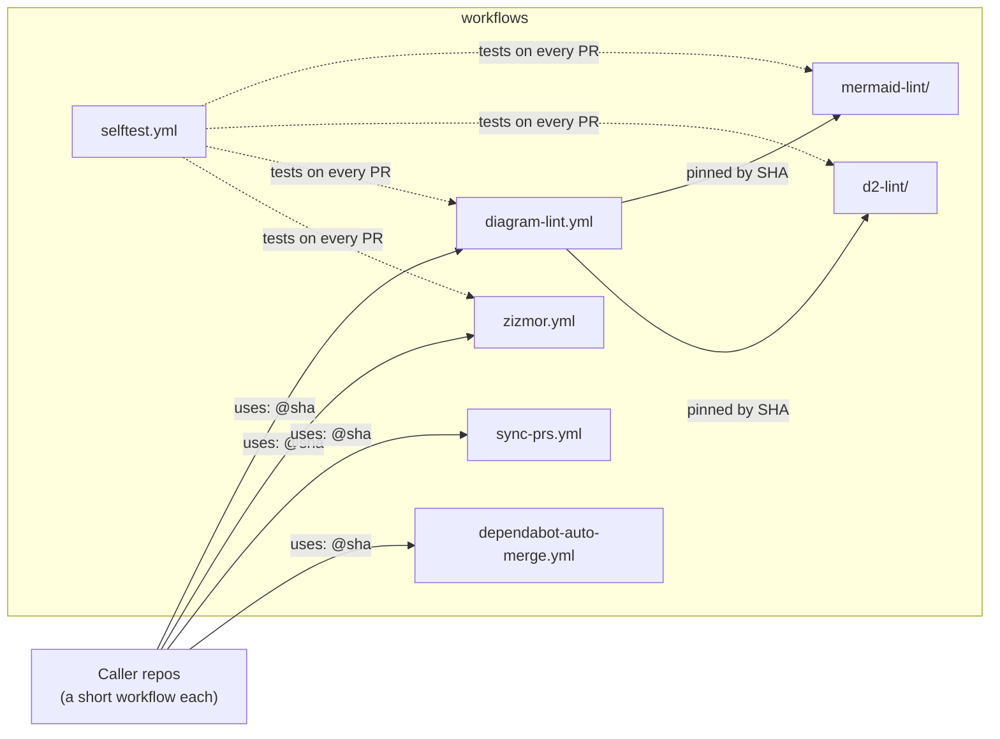

# workflows

Shared GitHub Actions for the AardeYamz repos: reusable workflows and the diagram linters they run. Each repo keeps a short caller workflow with its own triggers, concurrency and permissions, and `uses:` a template from here pinned by SHA, so CI logic and action bumps live in one place.

Public on purpose: GitHub doesn't let a public repo use a private repo's workflows or actions. Keep it free of secrets, hostnames and anything else repo-specific: those belong in the callers.

## Architecture



| Where | What |
|---|---|
| `.github/workflows/` | the four reusable workflows, and `selftest.yml` |
| `mermaid-lint/`, `d2-lint/` | the diagram linters, each a composite action (`action.yml`) around `lint.mjs`, with fixtures in `test/` |
| `.github/dependabot.yml` | weekly bumps of the pinned actions and the linters' npm dependencies |

## Reusable workflows

| Workflow | Inputs | What it does |
|---|---|---|
| [`diagram-lint.yml`](.github/workflows/diagram-lint.yml) | `mermaid` (default `true`), `d2` (default `false`) | Runs [`mermaid-lint`](mermaid-lint/) and/or [`d2-lint`](d2-lint/) on the caller's repo |
| [`zizmor.yml`](.github/workflows/zizmor.yml) | `advanced-security` (default `true`) | Lints the caller's workflow files with [zizmor](https://docs.zizmor.sh) and uploads SARIF to code scanning. Private repos without code scanning pass `false` to get annotations and a failing job instead |
| [`sync-prs.yml`](.github/workflows/sync-prs.yml) | `base` (default `main`), `ci-owned-paths`, `dispatch-workflows`, `dispatch-on-base` | Merges the base branch into each open, behind, same-repo PR. Comments on conflicts, skips Dependabot PRs and merges that would change `.github/workflows/**`, and can re-run workflows on each updated branch or once on the base branch |
| [`dependabot-auto-merge.yml`](.github/workflows/dependabot-auto-merge.yml) | `required-workflow` (required), `merge-method` (default `squash`), `timeout-minutes` (default `30`) | Waits for a Dependabot PR's checks, then merges patch/minor bumps and dev-only majors. The caller must use `pull_request_target` |

Every workflow also takes `runs-on`. Left empty, it uses the caller's `vars.RUNNER`, else `ubuntu-26.04`. Each file's header comment has a sample caller and the permissions the caller must grant. A called job can't ask for more permissions than its caller grants, so grant everything listed.

### Sample callers

Copied from each file's header comment. Pin `<sha>` to the release you want and keep its tag as the comment.

**`diagram-lint`** needs only `contents: read`, the default.

```yaml
jobs:
  diagrams:
    uses: AardeYamz/workflows/.github/workflows/diagram-lint.yml@<sha> # v1.0.0
    with:
      d2: true
```

**`zizmor`** needs `contents: read`, `security-events: write` (uploads the SARIF) and `actions: read` (lets the upload read the run's metadata, needed in private repos).

```yaml
jobs:
  zizmor:
    permissions:
      contents: read
      security-events: write
      actions: read
    uses: AardeYamz/workflows/.github/workflows/zizmor.yml@<sha> # v1.0.0
    with:
      advanced-security: false  # private repos without code scanning
```

**`sync-prs`** runs after a push to the base branch and needs `contents: write` (pushes the merge commit), `pull-requests: write` (comments on a PR that conflicts) and `actions: write` (dispatches workflows; required even when `dispatch-workflows` is empty).

```yaml
on:
  push:
    branches: [main]
  workflow_dispatch:
concurrency:
  group: sync-prs
  cancel-in-progress: false
jobs:
  sync:
    permissions:
      contents: write
      pull-requests: write
      actions: write
    uses: AardeYamz/workflows/.github/workflows/sync-prs.yml@<sha> # v1.0.0
    with:
      ci-owned-paths: src/version.txt dist        # or a glob: '20*/*/version.txt'
      dispatch-workflows: build-test.yml security.yml   # run on each updated PR branch
      dispatch-on-base: deploy.yml                # run once on the base branch if any PR was updated
```

**`dependabot-auto-merge`** needs `contents: write` and `pull-requests: write`, and the caller must use `pull_request_target`, since Dependabot's `pull_request` runs get a read-only token. That is safe here: nothing from the PR head is checked out or run.

```yaml
on: # zizmor: ignore[dangerous-triggers]
  pull_request_target:
    branches: [main]
jobs:
  auto-merge:
    if: github.event.pull_request.user.login == 'dependabot[bot]'
    permissions:
      contents: write
      pull-requests: write
    uses: AardeYamz/workflows/.github/workflows/dependabot-auto-merge.yml@<sha> # v1.0.0
    with:
      required-workflow: Build & Test
```

## Diagram linters

Both are also usable directly as composite actions: `uses: AardeYamz/workflows/mermaid-lint@<sha>` (or `d2-lint`), after `actions/checkout`.

- **`mermaid-lint/`** parses every mermaid block in the repo's tracked `*.md` files with `mermaid.parse` (jsdom supplies the DOM).
- **`d2-lint/`** compiles every tracked `*.d2` file and every d2 block in tracked Markdown with [D2.js](https://www.npmjs.com/package/@terrastruct/d2), the official WASM build of d2, so no binary is needed. Compiling includes the layout, so it also catches unknown keywords and bad references. `@import`s between tracked `.d2` files resolve.

Each prints `file:line: message` for every broken diagram, writes `::error` annotations under Actions, and exits 1 if any fail. They check the source, not any rendered SVG. To run one locally, from the repo whose diagrams you edited, with this repo cloned next to it:

```
npm ci --prefix ../workflows/mermaid-lint && node ../workflows/mermaid-lint/lint.mjs
npm ci --prefix ../workflows/d2-lint && node ../workflows/d2-lint/lint.mjs
```

## Related repos

All current callers are private.

| Repo | Calls |
|---|---|
| [personal-domain-devops](https://github.com/AardeYamz/personal-domain-devops) | `diagram-lint`, `zizmor` |
| [trips](https://github.com/AardeYamz/trips), [personal-timeline](https://github.com/AardeYamz/personal-timeline), [lam-yan-lik](https://github.com/AardeYamz/lam-yan-lik), [37-bestick-rd](https://github.com/AardeYamz/37-bestick-rd) | `diagram-lint`, `sync-prs` |
| [personal-dns](https://github.com/AardeYamz/personal-dns), [personal-dns-acl](https://github.com/AardeYamz/personal-dns-acl), [personal-server](https://github.com/AardeYamz/personal-server) | `diagram-lint` |

## Releasing

1. Change things on a branch and open a PR. [`selftest.yml`](.github/workflows/selftest.yml) runs the linters from source, checks they reject broken diagrams, and calls the read-only templates (`diagram-lint`, `zizmor`) at the PR's commit.
2. When a linter changes, bump the SHA that `diagram-lint.yml` pins to the linter's new commit, in a follow-up PR.
3. After merging, tag the merge commit `vX.Y.Z`, create a release, and move the `v1` tag. Callers then bump to the new tag's SHA, with `# vX.Y.Z` as the comment.

## Licence

[MIT](LICENSE)
