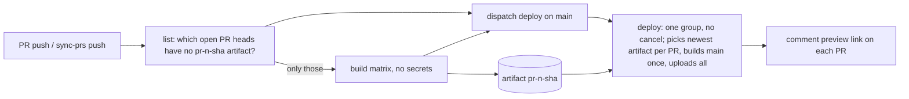

# Centralizing CI in `workflows`

Scan date: 2026-11-23. Covers every non-archived `AardeYamz` repo with a `.github/workflows/` folder (15 of 40; the rest are
coursework or forks with no CI). Run counts are the last 30 days, from the Actions API.

## Goals

1. **One copy of each pattern.** A repo's workflow files are short callers of `AardeYamz/workflows/...@<sha> # vX.Y.Z`;
   the logic lives here, is tested by `selftest.yml`, and reaches every repo through `bump-consumers.yml`.
2. **Self-running.** Merges, PR syncs, releases, consumer bumps and Dependabot updates need no clicks.
3. **Few builds.** No run builds something another run already built, a burst of events ends in one deploy, and docs-only
   changes start nothing but the diagram lint.

## What exists today

| Repo | Workflows | Runs / 30 d | Cancelled | Notes |
| --- | --- | ---: | ---: | --- |
| v3.yannislam.org | build-test, security, pr-previews, pr-previews-deploy, sync-prs, dependabot-auto-merge, release, vercel-build-warnings | 1000+ | 32 | Previews already deduplicated (the model below). Inline copies of sync-prs, zizmor, dependency-review, dependabot-auto-merge. 116 runs held as `action_required`. |
| trips | deploy, check, sync-prs, diagram-lint | 558 | 100 | Every run rebuilds main **and every open PR**. `push: branches: ['**']` plus `pull_request` runs twice per PR push. Floating `@v7` / `@v1` pins. |
| 37-bestick-rd | build, deploy (called), sync-prs, diagram-lint | 545 | 79 | Every run rebuilds every open PR (`site-prs`). Deploy job is correctly separated from PR code. |
| yl-theme | check, bump-consumers, sync-prs (inline), mermaid-lint (old linter) | 270 | 0 | `bump-consumers` starts on every Check run, PRs included, and the gate job exits. |
| lam-yan-lik | deploy, sync-prs, diagram-lint | 193 | 30 | Rebuilds every open PR each run (`tools/stage-previews.sh`). Calls `wrangler-action` directly, not the shared deploy action. |
| personal-timeline | build, sync-prs, diagram-lint | 176 | 36 | Rebuilds every open PR each run. **Fork PRs are not filtered out**, and PR code runs in the same job that later deploys with the Cloudflare token. Floating `@v7` / `@v1` pins. |
| personal-domain-devops | check, zizmor, diagram-lint, create-cloudflare-token | 138 | 0 | Home of `deploy/` (composite action), `worker/`, and the **old** `mermaid-lint/`. |
| Organizing-Scripts | ci, mermaid-lint (old linter, `ubuntu-latest`) | 117 | 0 | |
| personal-dns | terraform-lint, terraform-prod, diagram-lint | 104 | 0 | Terraform plan/apply is repo-specific; keep. |
| personal-financial-scripts | ci | 101 | 0 | `push:` on every branch plus `pull_request`: two runs per PR push. |
| workflows | selftest, release, bump-consumers, sync-main, scorecard + templates | 44 | 0 | |
| personal-dns-acl, personal-server, personal-messages, oneplus-dodge-updater | one lint or build each | ~20 each | 0 | |

Already centralized: `diagram-lint` (9 repos), `sync-prs` (4 repos), `zizmor` (personal-domain-devops).
Self-hosted runner: `vars.RUNNER = yl-home` in the private repos, so their minutes are free but share one machine; a
wasted build there delays every other repo's checks.

### Where the build time goes

The four Cloudflare sites (37-bestick-rd, trips, lam-yan-lik, personal-timeline) serve main and every PR preview from one
Worker, and a Worker deploy replaces all its assets. So each run today rebuilds **main plus all N open PRs** and deploys.
A merge to main makes `sync-prs` push to each of the N PRs, and each push starts another full run: about N × (N + 1) builds
for one merge, almost all of them thrown away by `cancel-in-progress` (the 245 cancelled runs above).

v3.yannislam.org has the same constraint (one Vercel project for all previews) and already solved it: build each PR once,
keep it as an artifact named `pr-<n>-<sha>`, and let a single-lane deploy assemble whatever is newest.

## Plan

Each phase is one PR in `workflows` (template + selftest), then one PR per consumer that switches to it. Consumer PRs are
small because the logic moves out of them.

### Phase 1: shared PR previews (biggest saving)

Add two reusable workflows, generalized from v3's `pr-previews.yml` / `pr-previews-deploy.yml`:

- **`preview-build.yml`** (`on: workflow_call`, called from the consumer's `pull_request` workflow). Inputs: `runtime`
  (`node` / `python`), `node-version` / `python-version`, `install` (e.g. `npm ci`), `build` (a command with `{n}` replaced
  by the PR number, e.g. `node tools/build.js --site out/37/pr-{n}`), `output` (folder to upload), `deploy-workflow`
  (file to dispatch). Jobs: `list` (same-repo open PRs whose head has no live artifact and no run in flight), `build`
  (matrix, no secrets, `persist-credentials: false`), `dispatch`. Skips Dependabot and forks.
- **`preview-deploy.yml`** (`on: workflow_call`, called from a consumer workflow with only `workflow_dispatch` and
  `push: [main]`). One concurrency group, `cancel-in-progress: false`, so a burst ends in at most two deploys. Inputs:
  `target` (`cloudflare` / `vercel`), the main build command, the URL pattern for comments. Downloads the newest
  `pr-<n>-<sha>` artifact per open PR, builds main once, uploads everything, and comments with a marker (`<!-- pr-previews -->`),
  falling back to the PR's previous build while its new one is still running. This job holds the deploy secret and runs no
  PR code.

Move `personal-domain-devops/deploy/` into this repo as `cloudflare-deploy/` (composite action) so the deploy template and
its action version together; leave a forwarding note in personal-domain-devops until no repo uses it.

Order: **personal-timeline first** (it also fixes the fork-PR / shared-job issue), then trips, lam-yan-lik, 37-bestick-rd,
and v3.yannislam.org last (it already works; it just drops ~280 lines).

Expected effect: a PR push builds one PR, not N + 1; a merge to main builds main once plus each PR once, and deploys once
or twice instead of N + 1 times.

### Phase 2: one CI entry point per repo

Many repos run 2-4 workflows per push (check, diagram lint, zizmor, security), each with its own checkout and setup. Add
**`ci.yml`** (`workflow_call`) that runs, as jobs in one run, whichever of these the caller turns on:
`diagram-lint`, `zizmor`, `codeql`, `dependency-review` (PRs only), and a `test` job that takes `install` / `test` commands.
It applies `paths` filtering inside (a `changes` job with `git diff --name-only`), so a docs-only PR skips the tests but
still reports the required checks as passed, which a workflow-level `paths:` cannot do for required checks.

Consumers then carry one `ci.yml` caller instead of `diagram-lint.yml` + `check.yml` + `security.yml`. Required-check
names stay stable (`ci / diagrams`, `ci / test`, ...); update each repo's ruleset in the same PR.

Also fix the double triggers while touching each repo: `trips` (`push: '**'`) and `personal-financial-scripts` (`push:`
with no branch filter) should push-trigger on the default branch only.

### Phase 3: finish moving inline copies onto the templates

| Repo | Inline today | Replace with |
| --- | --- | --- |
| v3.yannislam.org | `sync-prs.yml` (74 lines) | `sync-prs.yml` template with `dispatch-workflows: pr-previews.yml build-test.yml` |
| v3.yannislam.org | `security.yml` (zizmor) | `ci.yml` / `zizmor.yml` template |
| v3.yannislam.org | `dependabot-auto-merge.yml` | `dependabot-auto-merge.yml` template |
| v3.yannislam.org | dependency-review step in `build-test.yml` | `dependency-review.yml` template |
| yl-theme | `sync-prs.yml` (63 lines) | template |
| yl-theme, Organizing-Scripts | `mermaid-lint.yml` using `personal-domain-devops/mermaid-lint@v1` | `diagram-lint.yml` template |

Then delete `personal-domain-devops/mermaid-lint/` and update the global `CLAUDE.md` "Mermaid diagrams" section, which still
names it as the shared linter.

v3's 116 `action_required` runs are PR-preview runs held for approval after its inline sync-prs pushes. The template
pushes with `GITHUB_TOKEN` (which starts no `pull_request` run) and dispatches the checks instead, which should remove
them; confirm on the first sync after the switch.

### Phase 4: cross-repo bumps as one template

`yl-theme/bump-consumers.yml` and `workflows/bump-consumers.yml` are the same shape (open one PR per consumer on a fixed
branch). Add **`bump-consumers.yml`** as a reusable workflow taking a JSON list of `{repo, runtime, cmd, paths, notes}` and a
branch name; both repos become callers. Fix yl-theme's trigger while doing it: start on `push` to main with the release's
paths, or have its release job dispatch the bump, so the 170 PR Check runs no longer each start a gate job.

### Phase 5: Dependabot everywhere, auto-merged

Only 4 repos have `dependabot.yml`. Add one to every repo with CI (`github-actions` weekly, plus the repo's package
ecosystem), with `cooldown: 7 days` and grouped updates (one PR per ecosystem per week, not one per package), and call the
`dependabot-auto-merge.yml` template for patch/minor updates that pass CI. Grouping matters for the build budget: each
Dependabot PR is a preview build.

Pins to fix on the way (org standard is a full SHA with a tag comment): `trips/check.yml`, `trips/deploy.yml`,
`personal-timeline/build.yml` (`actions/*@v7`, `deploy@v1`), `Organizing-Scripts/mermaid-lint.yml` (`@v1`, `ubuntu-latest`).

### What stays in each repo

Repo-specific build commands and data (passed as inputs), `personal-dns` Terraform plan/apply, `personal-domain-devops`
token minting, v3's Vercel `release` / `vercel-build-warnings` (they react to Vercel's own deployments), and
`oneplus-dodge-updater`'s Windows/Rust build.

## Budget rules for every template

- `pull_request` and `push: [default branch]` only; never `push` on all branches alongside `pull_request`.
- `concurrency` per PR with `cancel-in-progress: true` for builds; one group, `cancel-in-progress: false` for deploys and
  pushes (GitHub keeps one waiting run and drops older waiting ones, which is the debounce).
- Build artifacts named by commit and reused; never rebuild a commit another run built.
- Path filtering inside the run, so required checks still report.
- `timeout-minutes` on every job; `retention-days: 14` on preview artifacts.
- Schedules: weekly at most (Scorecard, CodeQL), one cron per repo.
- `runs-on: ${{ inputs.runs-on || vars.RUNNER || 'ubuntu-26.04' }}` so private repos stay on `yl-home`.

## Tracking

Each phase, and each consumer migration within it, gets its own GitHub issue (labels `to-do`, `code`) linked from here.
